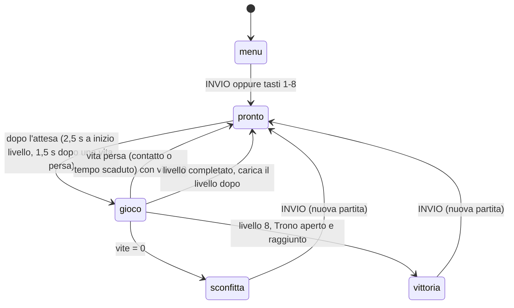

# 2. Progettazione — Pac-Man del Nord

Seconda fase del modello Waterfall. I requisiti dicono *cosa* fare; la progettazione decide *come*:
- in quali file dividere il codice;
- come i file parlano tra loro;
- quali stati attraversa il gioco;
- come sono fatti i livelli.

---

## 2.1 Scelte tecnologiche

| Scelta | Perché |
|---|---|
| **JavaScript + p5.js 1.9.4** | p5.js è l'erede di Processing, il linguaggio del progetto originale, quindi il confronto è diretto. Gira nel browser, senza installare niente (RNF3). |
| **Three.js r147** per la vista 3D principale | Dà luci, nebbia, ombre morbide e modelli veri. La 3D di p5 resta come ripiego. |
| **Web Audio API** per musica ed effetti | I suoni sono generati dal codice (oscillatori, filtri, rumore): niente file audio e niente problemi di licenza (RNF6). |
| **Node.js** per le prove | `verifica.js` fa girare la logica senza browser e senza installare niente (RNF8). |
| **localStorage** per il record | È già nel browser e non serve un server (RF9). |

---

## 2.2 Architettura: tre strati

L'idea centrale (RNF8) è separare **chi decide** da **chi mostra**.

```
                 ┌───────────────────────────────────────────┐
  tastiera ───►  │  sketch.js  (colla con p5)                │
                 │  setup()  draw()  keyPressed()            │
                 └──────┬───────────────┬──────────┬─────────┘
                        │ tasto(), aggiorna(dt)    │ legge lo stato
                        ▼                          ▼
     ┌──────────────── LOGICA ─────────┐   ┌──────── PRESENTAZIONE ────────┐
     │ gioco.js      (regole, stati)   │   │ vista_three.js  3D principale │
     │ giocatore.js  fantasma.js       │   │ ambiente.js     atmosfera     │
     │ entita.js     (movimento)       │──►│ modelli.js      personaggi    │
     │ labirinto.js  (muri, BFS)       │   │ vista3d.js      3D di ripiego │
     │ livelli.js    labirinti.js      │   │ vista2d.js      2D, HUD, mappe│
     │ costanti.js                     │   │ suoni.js        musica, effetti│
     └─────────────────────────────────┘   └───────────────────────────────┘
       non usa p5, non disegna:              legge, non scrive mai
       provata da verifica.js
```

- **Logica.** Conosce le regole e niente altro. Non sa se sullo schermo c'è la 2D o la 3D.
- **Presentazione.** Riceve l'oggetto `gioco` e lo disegna o lo fa suonare. Non cambia mai i valori del gioco.
- **Colla (`sketch.js`).** A ogni fotogramma fa tre cose in ordine: `gioco.aggiorna(dt)`, `disegnaScena()`, `aggiornaSuoni()`.

### Comunicazione logica → suoni: gli "eventi"
La logica non chiama mai l'audio direttamente. Quando succede qualcosa scrive un nome nella lista `gioco.eventi`, per esempio `'vitaPersa'`. A ogni fotogramma `sketch.js` svuota la lista e passa ogni nome a `suoni.effetto()`. La lista non supera mai 50 elementi.

Gli eventi sono: `inizioLivello`, `cibo`, `potenziamento`, `fantasmaMangiato`, `vitaPersa`, `sconfitta`, `livelloCompletato`, `troneAperto`, `vittoria`, `caccia`, `tick`.

### Catena di ripiego (RNF5)
```
VistaThree (Three.js) ──errore──► Vista3D (p5 WEBGL) ──errore──► Vista2D
```
Il ripiego c'è in due momenti:
- all'avvio, in `creaVista3D()`;
- durante il gioco, perché `disegnaScena()` è dentro un `try/catch`.

Se una vista dà errore, si passa da soli a quella dopo.

---

## 2.3 Mappa dei file

| File | Strato | Contenuto principale | Requisiti |
|---|---|---|---|
| `index.html` | — | carica le librerie e i file, in ordine | RNF3 |
| `costanti.js` | logica | tutte le costanti con un nome | RNF4 |
| `labirinti.js` | logica | gli 8 labirinti (`#` muro, `.` strada), tunnel, partenze, Trono | RF2, RF12 |
| `labirinto.js` | logica | classe `Labirinto`: `aperto`, `liberoVerso`, `vicini`, `distanze` (BFS) | RF2, RF3, RF6 |
| `livelli.js` | logica | tabella `REGNI`, funzione `parametriLivello(n)` | RF7, RF8, RF12 |
| `entita.js` | logica | classe `Entita`: movimento a celle basato sul tempo, tunnel, inversione | RNF2, RF3 |
| `giocatore.js` | logica | classe `Giocatore`: comandi assoluti e relativi, svolta che scade, cibo | RF1, RF16, RF18 |
| `fantasma.js` | logica | classe `Fantasma`: i 3 comportamenti, dispersione, fuga | RF4, RF6, RF15 |
| `gioco.js` | logica | classe `Gioco`: stati, vite, punti, contatti, Trono, record, prova | RF5–RF11, RF20 |
| `sketch.js` | colla | finestra, tasti, scelta della vista, ripiego, audio | RF14, RNF5 |
| `vista2d.js` | presentazione | `TEMI` (colori), vista 2D, barra, minimappe, guida alle svolte, messaggi | RF12, RF16 |
| `vista_three.js` | presentazione | `VistaThree`: scena 3D, camera, personaggi, decorazioni | RF14, RF17, RF19 |
| `ambiente.js` | presentazione | `AMBIENTI`, texture generate, `Particelle`, torce | RF19 |
| `modelli.js` | presentazione | modelli 3D (generati da `tools/bake.py`) | RF17 |
| `vista3d.js` | presentazione | `Vista3D` (ripiego p5) e funzioni di geometria condivise | RF14 |
| `suoni.js` | presentazione | `MUSICHE`, `Suoni`: musica ed effetti in Web Audio | RF13 |
| `verifica.js` | prove | 137 prove automatiche collegate ai requisiti | tutti |
| `tools/` | strumenti | prove delle viste con una libreria finta; `bake.py` | RNF5, RF17 |

### Le classi che si muovono nel labirinto
```
           Entita            (posizione, direzione, velocità, aggiorna(dt))
          /      \
   Giocatore    Fantasma      (ognuno decide scegliDirezione() a modo suo)
```
`Entita` sa *come* muoversi da una cella all'altra. Le due figlie decidono *dove* andare. Questo si chiama **ereditarietà**: il codice comune sta in un posto solo.

---

## 2.4 Macchina a stati (`gioco.js`)



| Stato | Cosa succede | Come si esce |
|---|---|---|
| `menu` | schermata iniziale | INVIO → livello 1; tasti 1–8 → livello scelto |
| `pronto` | breve pausa; i personaggi sono fermi | finita l'attesa → `gioco` |
| `gioco` | movimento, contatti, cibo, fasi, tempo limite | vita persa / livello finito → `pronto`; 0 vite → `sconfitta`; Trono → `vittoria` |
| `sconfitta` | messaggio; il record viene salvato se è più alto | INVIO |
| `vittoria` | messaggio; il record viene salvato se è più alto | INVIO |

### Sotto-stato dei fantasmi: dispersione e caccia
Durante lo stato `gioco` i fantasmi alternano due fasi, che si ripetono di continuo:

```
dispersione 7 s  →  caccia 20 s  →  dispersione 7 s  →  caccia 20 s  →  ...
```

- **Dispersione:** "insegue" va nell'angolo in alto a destra e "anticipa" in quello in alto a sinistra; il giocatore respira.
- **Caccia:** attaccano.
- **Potenziamento:** sopra le due fasi c'è lo stato `spaventato`. Finché il potere dura, i fantasmi scappano.

Il conteggio riparte da zero dopo una vita persa e quando si apre il Trono.

---

## 2.5 Tabella dei livelli (`livelli.js`)

I valori sono calcolati da `parametriLivello(n)` a partire dalle costanti (RF7, RF8).

| Liv. | Regno | Casata | Velocità fantasmi (celle/s, in 2D) | Uscita fantasmi (s) | Potere (s) | Tempo limite | Tunnel |
|---|---|---|---|---|---|---|---|
| 1 | Il Nord | Stark | 2,4 | 3 / 8 / 12 | 6 | — | 1 |
| 2 | Isole e Fiumi | Greyjoy e Tully | 2,5 | 2,5 / 7,5 / 11,5 | 5 | — | 1 |
| 3 | Montagna e Valle | Arryn | 2,6 | 2 / 7 / 11 | 4 | — | 1 |
| **4** | **La Roccia** ★ | Lannister | 2,9 | 1,5 / 6,5 / 10,5 | 3 | **150 s** | 2 |
| 5 | L'Altopiano | Tyrell | 2,8 | 1 / 6 / 10 | 3 | — | 1 |
| 6 | Terre della Tempesta | Baratheon | 2,9 | 1 / 5,5 / 9,5 | 3 | — | 1 |
| 7 | Dorne | Martell | 3,0 | 1 / 5 / 9 | 3 | — | 1 |
| **8** | **Approdo del Re** ★ | Targaryen | 3,2 | 1 / 4,5 / 8,5 | 3 | **140 s** | 2 |

★ = livello speciale. In 3D la velocità dei fantasmi si moltiplica per 0,75 (RF15). Il giocatore va sempre a 3,5 celle/s.

**Formula della velocità:** `min(3,2 ; 2,4 + 0,1 × (n − 1) + 0,2 se speciale)`.

### Atmosfera per regno (`ambiente.js`, solo Three.js)

| Regno | Muri | Particelle | Particolarità |
|---|---|---|---|
| Nord | pietra, cime innevate | neve | torce |
| Isole e Fiumi | pietra scura | pioggia | torce |
| Valle | pietra chiara | neve leggera | nebbia chiara e lontana |
| Roccia | marmo cremisi, fregi d'oro | pagliuzze d'oro | stendardi con disco d'oro, pavimento a scacchi |
| Altopiano | siepi di altezza irregolare | lucciole | viottoli di ghiaia, nessuna torcia |
| Tempesta | roccia grezza | pioggia obliqua | **lampi** |
| Dorne | arenaria con fascia rossa | sabbia nel vento | giare, palme, cactus |
| Trono | pietra grigia | pulviscolo | sala del castello: colonne, finestre accese, stendardi, tappeto |

---

## 2.6 Algoritmi principali

| Algoritmo | Dove | Idea in parole semplici |
|---|---|---|
| **Ricerca in ampiezza (BFS)** | `Labirinto.distanze` | Parte da una cella e scrive "1" sulle vicine, "2" sulle vicine delle vicine, e così via. Alla fine ogni cella sa quanti passi la separano dal punto di partenza. |
| **Movimento a celle basato sul tempo** | `Entita.aggiorna` | `prog` va da 0 a 1 tra una cella e l'altra. A ogni fotogramma avanza di `velocità × dt`. Al centro della cella si sceglie la direzione successiva. |
| **Scelta del fantasma** | `Fantasma.scegliDirezione` | Tra le strade (senza tornare indietro) prende quella con la distanza BFS più piccola dal bersaglio. Se è spaventato prende la più lontana dal giocatore; se è "casuale" sceglie a caso. |
| **Contatto** | `Gioco.controllaContatti` | Distanza vera (con i decimali) minore di 0,6 celle: così non si "passa attraverso". |
| **Camera che ruota** | `aggiornaAngolo` + `differenzaAngoli` | A ogni fotogramma l'angolo si avvicina alla direzione del personaggio, nel verso più breve. |

---

## 2.7 Comandi

| Tasto | 2D (assoluti) | 3D (relativi) |
|---|---|---|
| ↑ | verso l'alto dello schermo | avanti (annulla la svolta prenotata) |
| ← / → | verso sinistra / destra dello schermo | gira al prossimo incrocio (la prenotazione vale 1 s) |
| ↓ | verso il basso (se è la direzione opposta, inverte subito) | inversione di marcia |
| INVIO / spazio | avvia, riavvia | uguale |
| 1–8 | dal menu: scelta del livello | uguale |
| V | passa dalla 2D alla 3D e viceversa | uguale |
| N | mostra o nasconde la mappa ferma | uguale |
| M | audio sì / no | uguale |
| P / E | modalità prova / completa il livello (solo in prova) | uguale |
